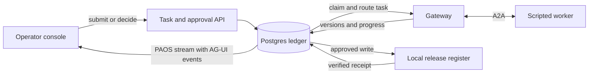

# PAOS Core

A local control plane for agent tasks, artifacts, and consequential actions. Submit a sample changelog for release
review, see why PAOS selected a worker, and inspect the draft before deciding whether to record it.


## Run the walkthrough

Requirements are Git, Docker Engine 28 or later with Compose v2, and OpenSSL. On macOS, start
Docker Desktop first. Run these commands from your checkout.

```sh
./scripts/setup
docker compose up --build --wait -d
./scripts/operator-token
```

Open **http://127.0.0.1:8765** and enter the local operator token printed by the last command.
Start a release review. The two draft versions, diff, approval, and receipt all belong to one
task. Open **Governed memory** to see which synthetic claims are eligible for task context.

Try the [restart and denial walkthrough](docs/recovery-walkthrough.md). The test suite checks
that a blocked peer receives no task data, a restart does not dispatch twice, and a crash
between the register write and receipt does not repeat the write.

The stack runs entirely on your machine with a scripted A2A worker. Set `PAOS_PORT` before
starting if the default port is already in use. `docker compose down` stops the stack and retains
its database volume.

## What the system owns



- **Task and run.** A classification rule excludes a public-only peer before any data is
  dispatched. The gateway persists the selected peer's task handle so it can reattach after
  restarting.
- **Artifact.** The worker returns two versions of a short report. The operator can inspect
  lineage, compare the text, and download a verified version.
- **Effect.** An approval applies to a specific version digest. The local register has a unique
  key per task. If the gateway stops after writing the row, it can verify that row and recover
  the receipt without repeating the write.
- **Memory.** The example applies PAOS's structured selection rules to synthetic claims. The
  selected projection contains accepted facts with evidence. The operator view explains why
  pending and higher-classification claims were withheld.

This release is a single-operator, loopback deployment. The wider PAOS design has runtime
admission and tool mediation boundaries. This slice exercises classification and one mediated
write, with deterministic fixtures and a separate process for the A2A worker. The AG-UI client
uses PAOS's SSE envelope to apply each snapshot at a durable sequence number.

See [integration and operations](docs/operations.md) for extension contracts, verification,
and recovery.

PAOS Core is available under the [MIT license](LICENSE). See the [contribution guide](CONTRIBUTING.md)
and [security reporting policy](SECURITY.md).
